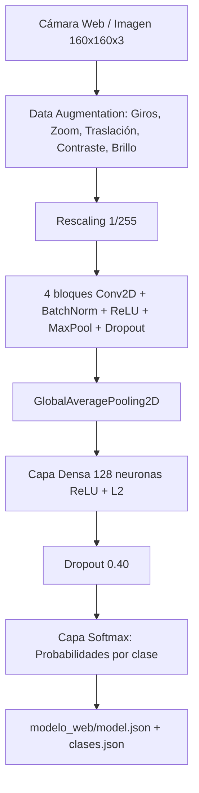
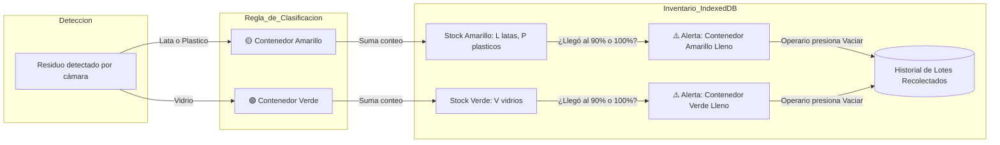

# ♻️ Punto Verde Inteligente — Documentación Técnica del Sistema

## 1. Visión General
**Punto Verde Inteligente** es un sistema híbrido de Visión Artificial e Inventario en tiempo real diseñado para automatizar la clasificación y el conteo de residuos reciclables (latas, botellas de plástico y vidrio). 

El sistema combina:
1. **Modelo de Clasificación (Transfer Learning con MobileNetV2)**: Reconoce el tipo de residuo frente a una cámara web.
2. **Lógica de Asignación de Contenedores**: Indica el color del tacho correspondiente (Amarillo o Verde).
3. **Control de Inventario y Capacidad (IndexedDB)**: Registra la cantidad de objetos acumulados en cada contenedor y emite alertas de "Contenedor Lleno" para su vaciado o recolección.

---

## 2. Arquitectura de la Red Neuronal (CNN propia)



### ¿Por qué una CNN propia?
* El pipeline actual (`entrenar.py`) entrena una **CNN convolucional propia desde cero** con 4 bloques (32→64→128→256 filtros), `BatchNormalization` tras cada convolución y `GlobalAveragePooling2D` antes de la cabeza densa.
* La entrada es de **160x160x3** con `Rescaling(1/255)` integrado en el modelo, por lo que el navegador envía píxeles en rango 0-255.
* El entrenamiento aplica **Data Augmentation** solo a las imágenes de entrenamiento (cacheando las imágenes limpias, no las aumentadas) y **pesos por clase** (`class_weight`) para compensar el desbalance y reforzar `vidrio`.
* El script imprime al final la **accuracy por clase y la matriz de confusión**: no despliegues si `vidrio` queda por debajo de ~0.85.
* Nota histórica: existió una versión con **MobileNetV2** (transfer learning, 224x224) guardada en `modelo_reciclaje.keras`; fue reemplazada por esta CNN propia. Ese artefacto antiguo ya no se usa.

---

## 3. Estructura del Dataset y Prevención de Falsos Positivos

El dataset se organiza en subdirectorios dentro de `dataset/`:

```text
dataset/
├── fondo/       <- [CLAVE] 20 a 40 fotos del mostrador vacío, pared o manos vacías
├── lata/        <- 40 a 50 fotos de latas de aluminio (gaseosas, cervezas, conservas)
├── plastico/    <- 40 a 50 fotos de botellas plásticas (PET, agua, refrescos)
└── vidrio/      <- 40 a 50 fotos de botellas o frascos de vidrio
```

### El problema de la "Cámara Apuntando a la Nada"
En un clasificador tradicional con solo `[lata, plastico, vidrio]`, la función de activación `Softmax` obliga a que las probabilidades sumen el 100%. Si la cámara enfoca una pared blanca o una persona, el modelo elegirá forzosamente una de las 3 opciones (ej. "Vidrio 60%").

**Solución aplicada en la arquitectura:**
1. **Clase `fondo`:** Entrenamos al modelo para reconocer cuándo el campo visual está vacío.
2. **Umbral de Confianza (Thresholding):** Si la certeza es menor al 70%, el sistema no clasifica y permanece en estado `Esperando residuo...`.

---

## 4. Datasets Públicos Recomendados

Si no deseas tomar todas las fotos manualmente con tu cámara o celular, puedes utilizar estos datasets abiertos de alta calidad:

### Opción A: TrashNet (El estándar académico para reciclaje)
* **Creado por:** Gary Thung y Mindy Yang (Universidad de Stanford).
* **Contenido:** Contiene más de 2,500 fotos de residuos sobre fondo blanco bien iluminado.
* **Categorías aplicables:**
  * `glass` -> Copiar imágenes a `dataset/vidrio/`
  * `metal` -> Copiar imágenes a `dataset/lata/`
  * `plastic` -> Copiar imágenes a `dataset/plastico/`
* **Dónde conseguirlo:**
  * **Hugging Face:** [garythung/trashnet](https://huggingface.co/datasets/garythung/trashnet)
  * **GitHub:** [github.com/garythung/trashnet](https://github.com/garythung/trashnet)

### Opción B: Kaggle Garbage Classification Dataset
* **Búsqueda en Kaggle:** `asdasdasasdas/garbage-classification` o `mostafaabla/garbage-classification`
* Contiene miles de imágenes clasificadas en: Cardboard, Glass, Metal, Paper, Plastic, Trash.

### Opción C: Drinking Waste Classification (Específico para Bebidas)
* **Búsqueda en Kaggle:** `Drinking Waste Classification`
* Enfocado exclusivamente en latas de aluminio, botellas PET y botellas de vidrio. Es ideal para este proyecto porque solo contiene envases de bebidas.

---

## 5. Lógica del Inventario de Contenedores y Almacén

Cada residuo clasificado tiene una ruta de disposición y un control de stock en tiempo real:



### Reglas de Negocio:
1. **Contenedor Amarillo:**
   * Recibe: Latas de aluminio y envases de plástico.
   * Capacidad de ejemplo: 100 unidades.
   * Inventario desglosado: `Latas: X`, `Plásticos: Y`, `Total: X + Y`.
2. **Contenedor Verde:**
   * Recibe: Botellas y frascos de vidrio.
   * Capacidad de ejemplo: 50 unidades (menor capacidad por peso y riesgo de rotura).
   * Inventario: `Botellas de vidrio: Z`.
3. **Mecanismo de Alerta y Vaciado:**
   * Al alcanzar el 90% de la capacidad, se notifica visualmente.
   * Al alcanzar el 100%, se bloquea el depósito hasta que el operario presione `Vaciar Contenedor`.
   * El evento de vaciado registra en IndexedDB: fecha, hora, cantidad de residuos retirados y reinicia el contador a 0.

---

## 6. Guía de Ejecución

### Paso 1: Instalar dependencias
```powershell
cd c:\botellas\reciclaje_ai
pip install -r requirements.txt
```

### Paso 2: Poblar el dataset
Coloca al menos 25 a 40 imágenes en cada una de las carpetas:
* `dataset/lata/`
* `dataset/plastico/`
* `dataset/vidrio/`
* `dataset/fondo/` (fotos de la mesa o mostrador sin objetos)

### Paso 3: Entrenar el modelo
```powershell
python entrenar.py
```
El script realizará:
1. Verificación automática de la cantidad de fotos por categoría.
2. Descarga y ajuste de MobileNetV2 con Data Augmentation.
3. Generación de `modelo_web/clases.json` y `modelo_web/model.json`.

### Paso 4: Iniciar el Punto Verde Web
```powershell
python -m http.server 8000
```
Abre en tu navegador: **http://localhost:8000**
